<p align="center">
  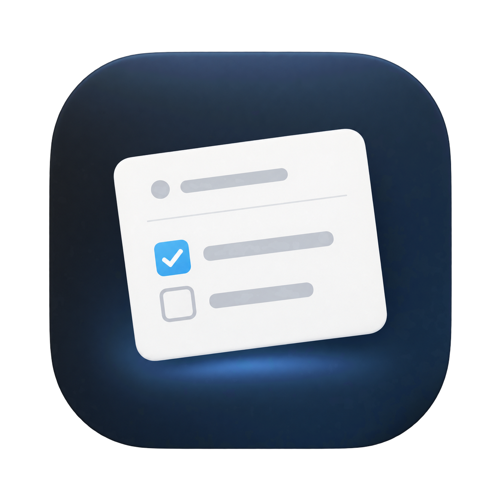
</p>

<h1 align="center">HeptaFloat</h1>

<p align="center">
  <b>Today's Heptabase journal, one keystroke away.</b><br>
  A small floating card that sits above your other windows — jot a thought, tick a to-do, and get back to work.
</p>

<p align="center">
  <a href="https://github.com/madeyexz/heptafloat/releases/latest"><b>⬇︎ Download for Mac</b></a>
  &nbsp;·&nbsp; macOS 13 or later &nbsp;·&nbsp; Apple Silicon & Intel &nbsp;·&nbsp; Free & open source
</p>

<p align="center">
  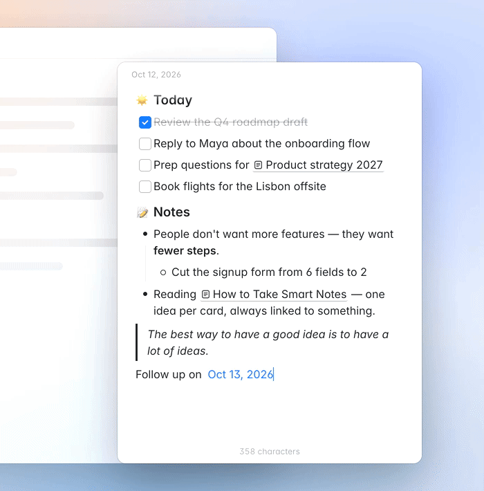<br>
  <a href="docs/demo-4x3.mp4"><b>▶ Watch the 1-minute tour of every feature</b></a>
</p>

---

## Why

Opening Heptabase, finding today's journal, and switching back breaks your flow. HeptaFloat keeps today's journal in a little card you can pop up from anywhere — like Raycast Notes, but it **is** your Heptabase journal. Everything you type is saved straight into Heptabase, and anything you add in Heptabase shows up in the card.

## What you get

| | |
|---|---|
| 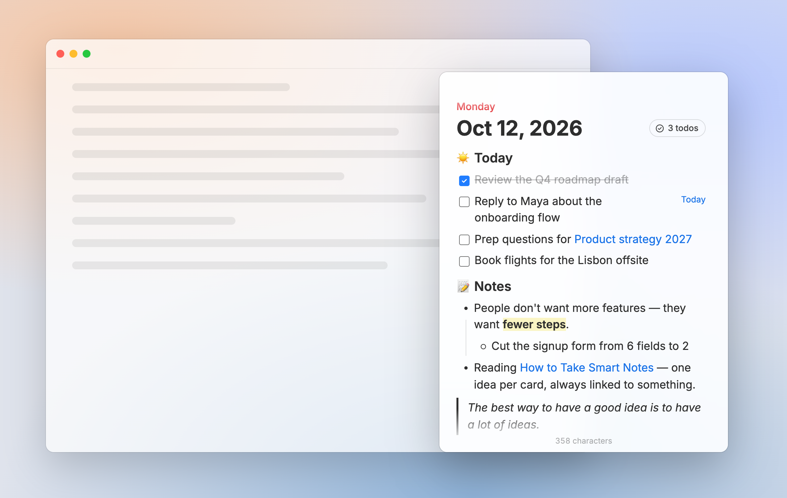 | 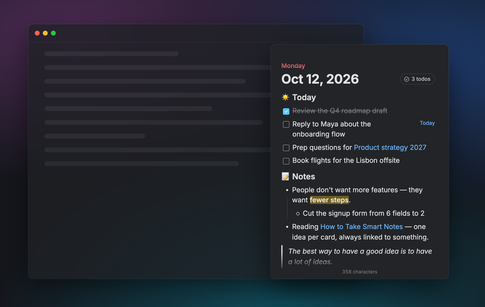 |
| **Floats above everything.** Put it anywhere on screen; it stays on top across desktops and full-screen apps. | **Looks like Heptabase.** Same font (Inter), colors, checkboxes, lists, link previews and highlights — in light and dark. |
| 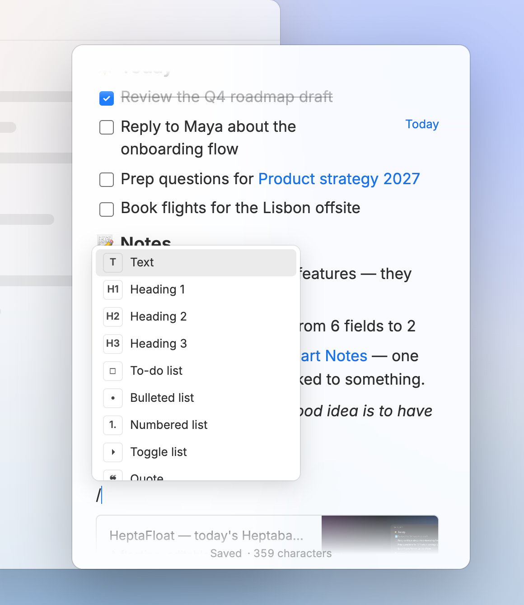 | 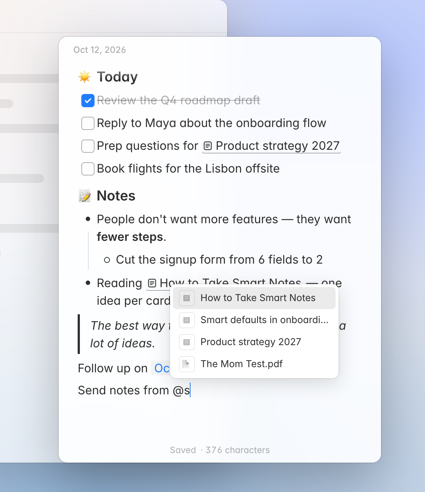 |
| **Type `/` for blocks** — to-dos, headings, bullets, toggles, quotes, dividers, today's date. | **Type `@` to mention a card** from your Heptabase library. Click a mention to open it in Heptabase. |

- **One shortcut to show and hide** — <kbd>⌃</kbd> <kbd>⌥</kbd> <kbd>J</kbd> by default; record any shortcut you like in Settings.
- **Jump to any card** — <kbd>⌘</kbd> <kbd>O</kbd> searches your Heptabase cards, <kbd>⌘</kbd> <kbd>P</kbd> shows the cards you've opened in HeptaFloat, <kbd>⌘</kbd> <kbd>T</kbd> goes back to today.
- **New card in a keystroke** — <kbd>⌘</kbd> <kbd>N</kbd> opens a blank card, like Raycast Notes. It's created in Heptabase as soon as you type (and not at all if you don't).
- **Images** — pictures from Heptabase show up, and you can paste or drop images into the card.
- **Saves as you type** and stays in sync with Heptabase both ways.
- **Always today's page** — at midnight it moves to the new day's journal on its own.
- **Simple settings** — shortcut, theme, text size, keep on top, launch at login, and a check that Heptabase is connected.

## Install

1. **Download** `HeptaFloat-x.y.z.zip` from the [latest release](https://github.com/madeyexz/heptafloat/releases/latest) and double-click it to unzip.
2. **Drag `HeptaFloat`** into your **Applications** folder.
3. **Open it.** Because HeptaFloat isn't from the App Store, macOS will warn you the first time:
   - Click **Done** (or **Cancel**) on the warning.
   - Open **System Settings → Privacy & Security**, scroll down, and click **Open Anyway** next to HeptaFloat.
   - Confirm with **Open**. You only need to do this once.

### One-time setup in Heptabase

HeptaFloat talks to Heptabase through Heptabase's built-in **CLI** (its local connection for other apps).

1. Make sure the **Heptabase desktop app** is installed and running.
2. In Heptabase, open **Settings → AI Features** and turn on the **CLI**. Heptabase may require an active subscription for this.
3. That's it — open HeptaFloat and today's journal appears.

To double-check, open **HeptaFloat → Settings…** (<kbd>⌘</kbd> <kbd>,</kbd>). The **Heptabase** section shows a green **Connected** when everything is set up, or tells you what's missing (Heptabase not running, CLI turned off, …).

## Jump between cards

| 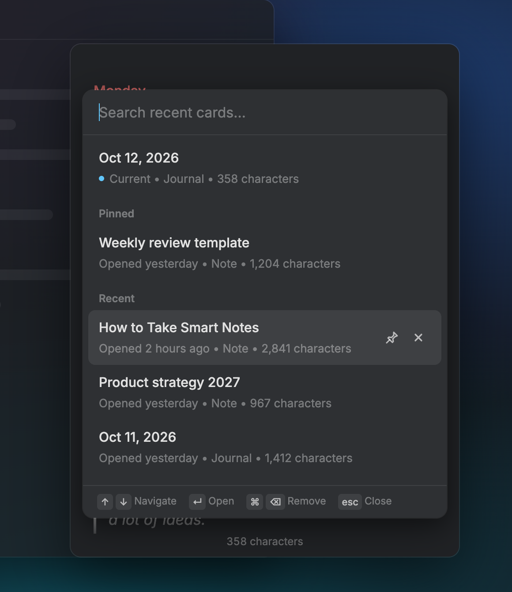 | 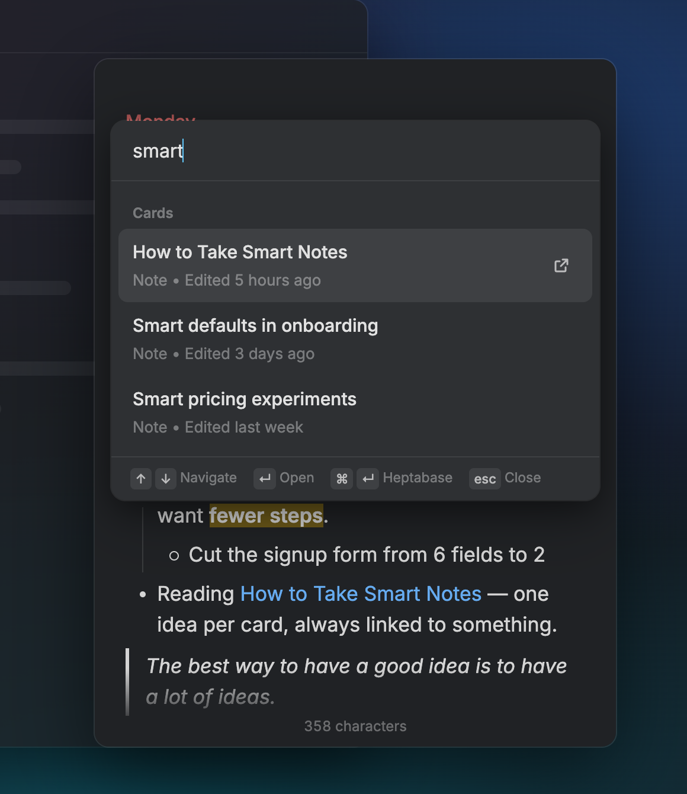 |
|---|---|
| **<kbd>⌘</kbd> <kbd>P</kbd> Recent cards** — the cards you've opened in HeptaFloat (its own list, kept on your Mac). Pin favorites to the top; × removes a card from the list (it never deletes anything in Heptabase). | **<kbd>⌘</kbd> <kbd>O</kbd> Search cards** — search everything in Heptabase. <kbd>↵</kbd> opens the card right here, <kbd>⌘</kbd> <kbd>↵</kbd> opens it in Heptabase. |

Notes and journals open in the floating card and are editable just like today's journal; other card types (PDFs, highlights…) open in Heptabase. <kbd>⌘</kbd> <kbd>T</kbd> takes you back to today's journal.

**Links to other cards:** hover or click a card mention to choose **Open here** or **Open in Heptabase**. <kbd>⌘</kbd>-click goes straight to Heptabase.

## How to use it

| Do this | To |
|---|---|
| <kbd>⌃</kbd> <kbd>⌥</kbd> <kbd>J</kbd> | Show or hide the card from any app |
| <kbd>Esc</kbd> | Hide it and go back to what you were doing |
| Drag the top edge | Move it; drag any edge to resize (it remembers) |
| `/` | Insert a block: to-do, heading, list, toggle, quote, code, divider, date |
| `@` or `[[` | Mention a card |
| Select text | Bold, italic, underline, strikethrough, code, link, **highlight & text color** |
| <kbd>⌘</kbd> <kbd>⇧</kbd> <kbd>H</kbd> | Highlight the selection in yellow (press again to remove) |
| <kbd>Tab</kbd> / <kbd>⇧</kbd> <kbd>Tab</kbd> | Indent / outdent a list item |
| <kbd>⌘</kbd> <kbd>↩</kbd> | Tick or untick a to-do |
| <kbd>⌘</kbd> <kbd>N</kbd> | New card |
| <kbd>⌘</kbd> <kbd>O</kbd> / <kbd>⌘</kbd> <kbd>P</kbd> / <kbd>⌘</kbd> <kbd>T</kbd> | Search cards / recent cards / today's journal |
| <kbd>⌘</kbd> <kbd>⇧</kbd> <kbd>O</kbd> | Open the current card in Heptabase |
| <kbd>⌘</kbd> <kbd>=</kbd> / <kbd>⌘</kbd> <kbd>-</kbd> | Bigger / smaller text |

You can also type Markdown: `- ` bullets, `1. ` numbers, `[] ` to-dos, `# ` headings, `> ` quotes, `---` dividers.

### Settings

Press <kbd>⌘</kbd> <kbd>,</kbd> while the card is in front.

<p align="center">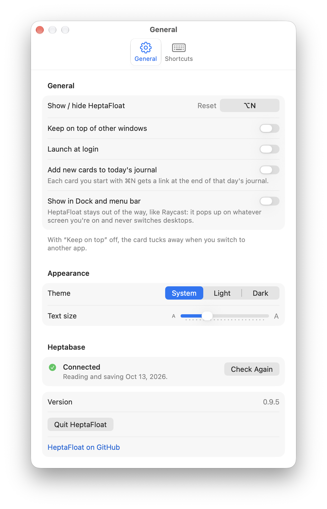</p>

- **Show / hide shortcut** — click the button and press the keys you want. <kbd>Esc</kbd> cancels, **Reset** goes back to <kbd>⌃</kbd> <kbd>⌥</kbd> <kbd>J</kbd>.
- **Keep on top of other windows** — on: the card stays open when you click into another app. Off: it tucks away as soon as you do. Either way it floats above everything, full-screen apps included.
- **Launch at login** — start HeptaFloat when you log in, so the shortcut always works.
- **Theme** and **Text size**.
- **Heptabase** — shows whether HeptaFloat can reach your journal, with **Check Again** and **Open Heptabase**.
- **Shortcuts** tab — every keyboard shortcut in one place. Click one and press new keys to change it; HeptaFloat warns you if the keys are already taken. **Reset All Shortcuts** restores the defaults.

<p align="center">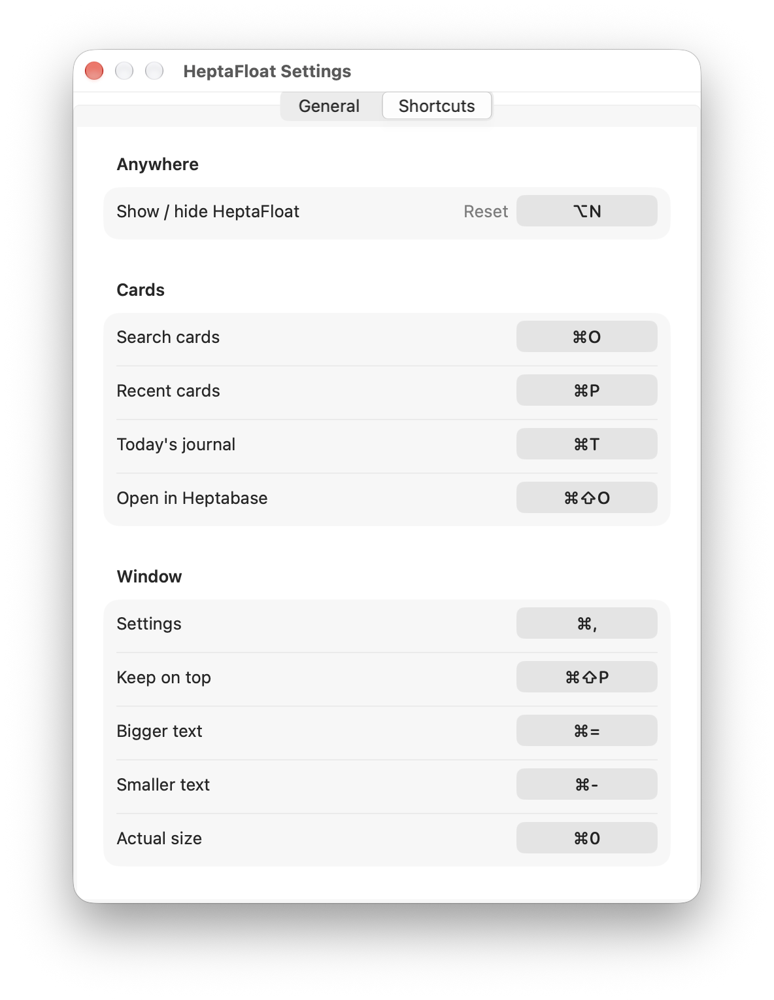</p>

- **Show in Dock and menu bar** — off by default. HeptaFloat then works like Raycast: no Dock icon, and the card pops up on whatever screen you're on — over full-screen apps too — without ever switching desktops. Turn it on to get a Dock icon and the menus at the top of the screen (File, Format, View, Window, Help), at the cost that opening HeptaFloat from a launcher can switch desktops.
- **Quit HeptaFloat** is at the bottom of Settings (or press <kbd>⌘</kbd> <kbd>Q</kbd> while the card is in front).

> Using Raycast or another launcher? A launcher hotkey that opens HeptaFloat works too — press it again to hide. Just don't give the launcher and HeptaFloat's own shortcut the same keys.

## How it works

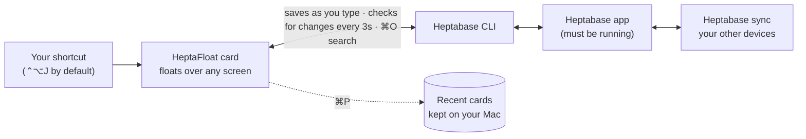

HeptaFloat never stores your notes or talks to the internet itself. It reads and saves through the Heptabase app on your Mac (via Heptabase's CLI), and Heptabase syncs as usual. The only thing HeptaFloat keeps is the ⌘P list of cards you've opened.

## Privacy

HeptaFloat runs entirely on your Mac. It reads and saves your journal through the Heptabase app on your computer and never sends your notes anywhere else. No accounts, no analytics.

## FAQ

**Does it work with notes other than the journal?** Yes — press <kbd>⌘</kbd> <kbd>O</kbd> to open any note or journal and edit it in the card. Other card types open in Heptabase.

**Will it mess up my journal?** HeptaFloat keeps everything it doesn't edit exactly as it was (images, embeds, colors, tables…). Each save is checked against the latest version in Heptabase, so it won't overwrite changes you made there.

**Is this made by Heptabase?** No — it's an independent, unofficial companion app.

---

## For developers

HeptaFloat is a native Swift shell (floating `NSPanel`, global hotkey, SwiftUI Settings) around a [ProseMirror](https://prosemirror.net) editor in a `WKWebView`. It reads and writes the journal with the Heptabase CLI (`heptabase journal read/save`), with md5 conflict checks.

```
Sources/main.swift   app shell: window, hotkey, menus, Settings, CLI bridge
src/schema.js        lossless ProseMirror schema for Heptabase's card format
src/editor.js        editor state, autosave, sync, day rollover
src/commands.js      list editing (indent, split, toggle…)
src/menus.js         "/" menu, @ mentions, selection toolbar, placeholders
src/palette.js       ⌘O search and ⌘P recent-card pickers
src/index.html       styles (Heptabase theme tokens, light/dark)
preview/             run the editor in a browser with a demo journal
```

**Build:** `./build.sh` (needs [Bun](https://bun.sh) and Xcode Command Line Tools) — builds a Universal app, installs it to `~/Applications`, and writes `dist/HeptaFloat-<version>.zip`.

**Try the editor without Heptabase:** `./preview/serve.sh`, then open <http://localhost:8765/stage.html>.

**Regenerate screenshots and the demo:** `./preview/capture.sh` (needs `agent-browser` and `ffmpeg`).

**Round-trip test:** `bun test/roundtrip.js <folder of journal JSON>` checks that loading and saving a journal changes nothing.

## License

[MIT](LICENSE) © 2026 Ian Hsiao. Bundles the [Inter](https://rsms.me/inter/) typeface under the [SIL Open Font License](src/fonts/OFL.txt).
Heptabase is a trademark of its owners; this project is not affiliated with Heptabase.
